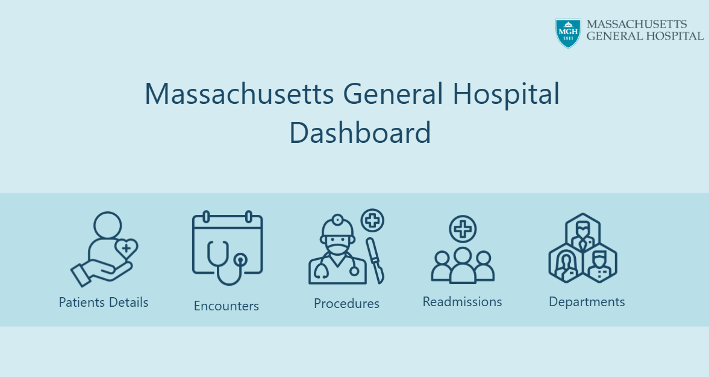
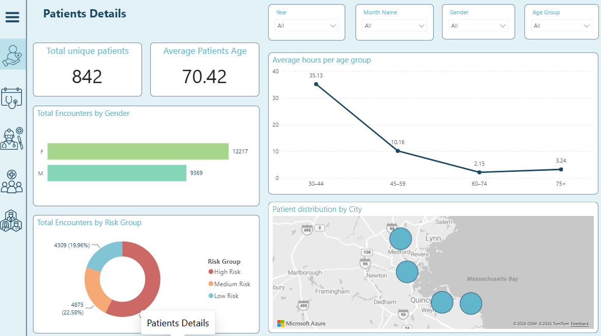
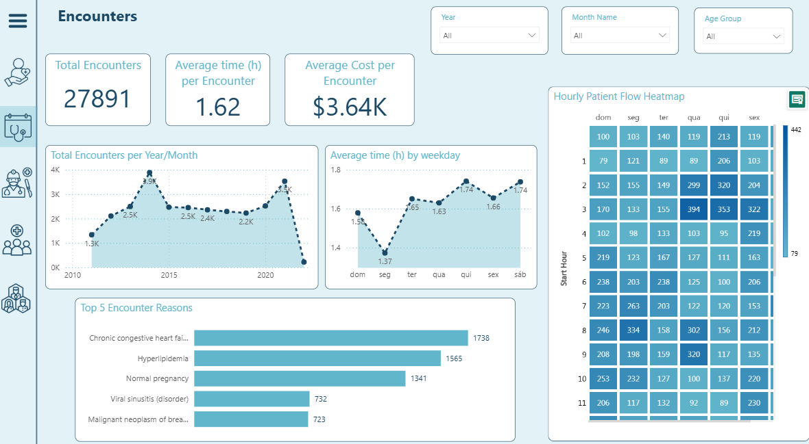
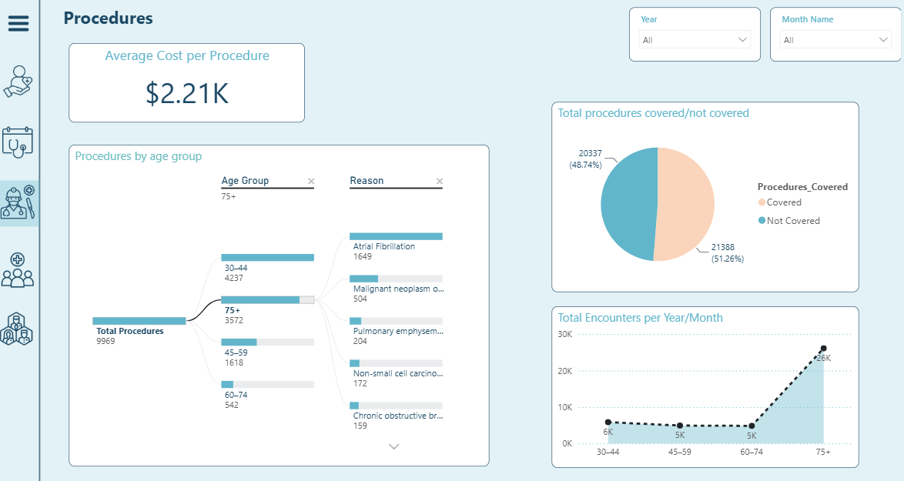
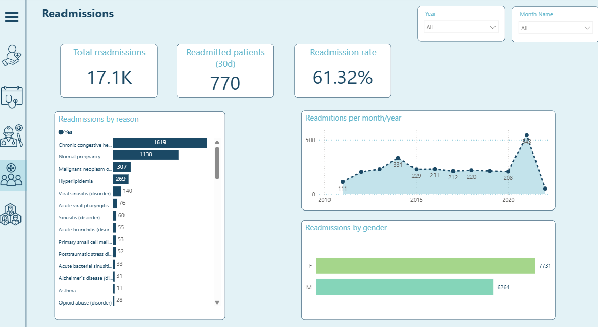
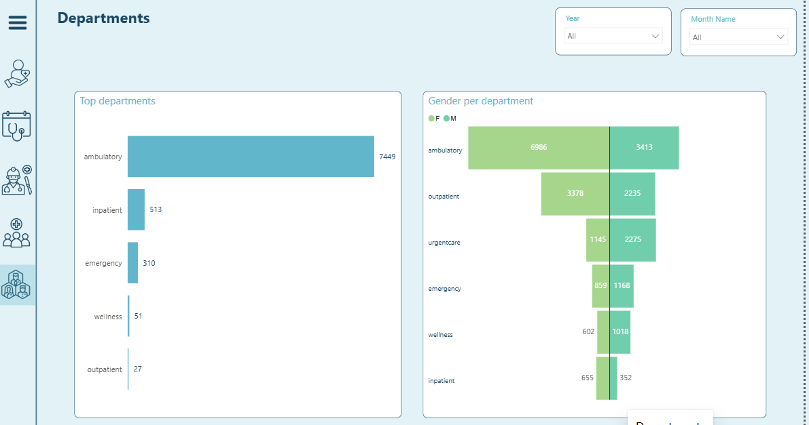

# Healthcare Analytics | Power BI

**Data modelling · Interactive dashboards · Healthcare analytics**

An academic Business Intelligence project developed at ISCTE, using synthetic hospital data to explore patient demographics, hospital encounters, procedures, costs, insurance coverage, departmental activity and 30-day readmissions.

## My contributions

- Structured a relational analytical data model and created supporting tables.
- Designed five interactive report pages and a navigation interface.
- Configured interactive filtering, report navigation and custom tooltips.
- Communicated healthcare KPIs through charts, maps, heatmaps and a decomposition tree.
- Applied **DAX measures supplied with the assignment**; the measures were not independently authored by me.

## Dashboards

### Navigation

### Patients

### Encounters

### Procedures

### Readmissions

### Departments

## 🔒 Full Power BI Report — Available Upon Request

The complete Power BI project (`.pbix`), including the data model, interactive dashboards and report configuration, is maintained in a **private repository** to protect the original academic work.

**Recruiters and hiring managers are welcome to request access** to review the full project. Access is granted individually upon request.

## Technical case study

[Read about the data model, reporting decisions and data provenance](docs/PROJECT.md).

## Tools

Power BI · Relational data modelling · Interactive visualisation · Reporting · Existing DAX measures

## Data source and access

The academic dataset contains **synthetic patient records**. Course materials cite Synthea: Walonoski et al. (2018), [*Synthea: An approach, method, and software mechanism for generating synthetic patients and the synthetic electronic health care record*](https://doi.org/10.1093/jamia/ocx079). A related public dataset is [Maven Analytics — Hospital Patient Records](https://mavenanalytics.io/data-playground/hospital-patient-records).

This is an academic case study, not an official Massachusetts General Hospital report. The complete Power BI report is available to recruiters upon request, as described above.

**Marta Santos** · Data Science portfolio
